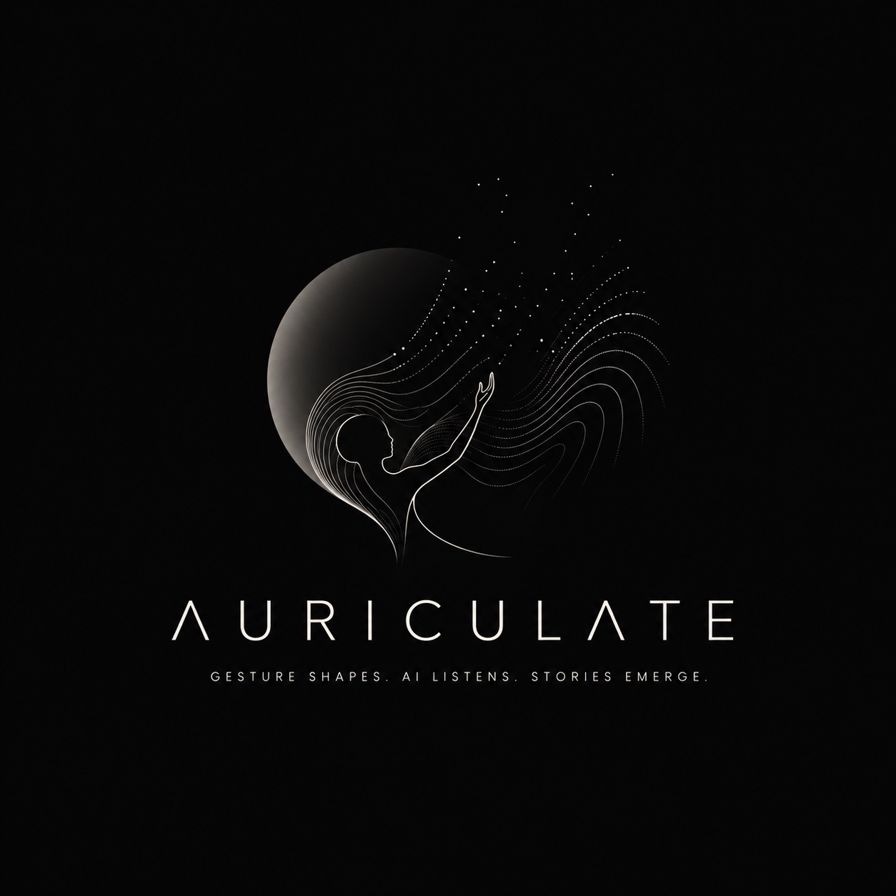

<a id="readme-top"></a>

<div align="center">
  

  <h2>Auriculate</h2>

  <p>
    Conduct a soundscape with your hands.
    <br/>
    Gesture-driven · Real-time · Performative
  </p>

<a href="https://voskamp099.github.io/Auriculate-Hackathon-2026/"><strong>Live Demo</strong></a>

</div>

## Table of Contents

- [About the Project](#about-the-project)
  - [Built with](#built-with)
- [Quick Start](#quick-start)
- [User Guide](#user-guide)
- [Sound Library](#sound-library)
- [Motivation](#motivation)
- [Contact](#contact)

## About the Project

**Auriculate** is a browser-based system where you:

- Use **hand gestures** to control sound
- Generate a **live soundscape in real time**
- Perform — not edit — your audio

No timeline. No post-production. Just presence.

## Built with

- MediaPipe Hands (hand tracking)
- Web Audio API
- Three.js (particle background)
- Vanilla JS, no framework

Latency target: **under 100 ms**

## Quick Start

The whole application is a single self-contained `index.html`. Serve the folder
over HTTP — ES modules and the camera both require it — and open the printed URL:

```bash
npx serve
```

Then open `http://localhost:3000` in a browser that allows camera access.

## User Guide

- Left hand controls **volume**, mapped by height, maximum at head height
- Right hand **triggers** sounds

### Ambience layer (default, looping)

| Gesture | Sound group |
| ------- | ----------- |
| Index   | Wind        |
| Peace   | Rain        |
| Three   | Thunder     |
| Pinky   | Birds       |
| Fist    | Silence     |

### SFX layer (one-shot)

| Gesture | Sound     |
| ------- | --------- |
| OK      | Dog bark  |
| Index   | Guzheng   |
| Peace   | Footsteps |
| Three   | Door knock |
| Fist    | Silence   |

### Switching layers

- Both hands thumbs up moves to SFX
- Both hands thumbs down returns to Ambience

### Behaviour notes

- Gesture detection is debounced, so a held pose does not retrigger a sound.
- In the **Ambience** layer, taking the right hand out of frame while a sound is
  playing turns the volume bar red and freezes it. The sound keeps playing
  hands-free; repeat the gesture to unlock.
- In the **SFX** layer there is no lock — the left hand controls the volume of
  the most recently triggered effect.
- In the **SFX** layer, taking the right hand out of frame leaves the ambience
  bed running underneath.
- Press `M` to mirror the camera horizontally.

## Sound Library

52 audio assets, grouped by role:

- `Audio Database/Ambience/` — City, Music, Percussion, Rain, Storm, Thunder, Wind
- `Audio Database/Sound Effect/` — one-shot effects

## Files

| File | Role |
| ---- | ---- |
| `index.html` | The entire application — HTML, CSS and JS in one file |
| `gesture_engine.js` | Earlier standalone Phase 8 implementation, kept for reference; not loaded |
| `logo.png`, `logo-transparent.png`, `logo-white.png` | Brand marks |
| `Audio Database/` | Sound assets |

## Motivation

AI makes content cheap — but removes the human moment.

Auriculate does the opposite:

> It keeps performance live, embodied, and unrepeatable.

Inspired by *kouji* — an ancient Chinese art of creating entire worlds using only the human voice.

## Contact

Auriculate Team — [Voskamp099](https://github.com/Voskamp099)

---

*Built during a 2026 hackathon.*
